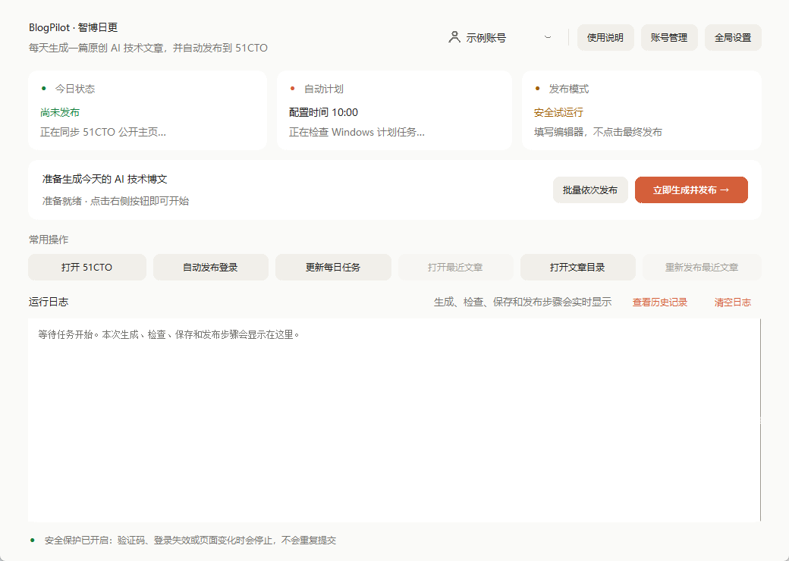
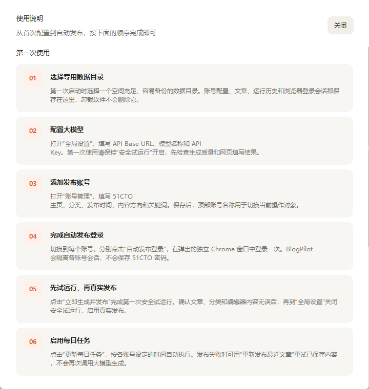

# BlogPilot（智博日更）

Windows 本地软件：为一个或多个 51CTO 账号分别生成原创 AI 技术博文，质量检查后按顺序自动发布。

在 VS Code 中调试时，可直接右键项目根目录的 `main.py`，选择“在终端中运行 Python 文件”。

## 当前能力

- 最多管理 5 个本地账号；切换账号会立即刷新该账号的今日状态、月度进度、文章与运行历史。
- 每个账号可独立设置主页、发布时间、月目标、文章分类、博文类型、内容方向和主题关键词；关键词会作为选题硬约束。
- 支持当前账号单独执行，也支持勾选多个账号后串行生成、串行发布；一个账号失败不会阻止后续账号。
- 不同账号当天的标题、主题和正文统一参与查重，避免生成相似文章。
- 发布失败后可直接重发当前账号已经保存的文章，不会再次调用大模型生成。
- 支持保存多个 OpenAI 兼容 API 连接和本机 Codex CLI 连接；所有账号共用一个当前连接，每个 API 连接分别保存密钥。
- 首次启动由用户选择专用数据目录；文章按账号保存在 `articles\generated_posts\<account_id>`，程序升级和卸载不会删除该目录。
- 检查字数、AI 主题、Markdown、密钥泄漏、标题和正文相似度。
- 使用 Windows DPAPI 加密 API Key。
- 优先使用电脑已有 Chrome；未安装 Chrome 时自动使用 Microsoft Edge，并为每个账号建立独立应用 Profile 和调试端口，不接触普通浏览器 Profile，也不会串用其他账号的登录窗口。
- 自动化浏览器禁用组件更新、后台同步和本地生成式 AI 功能，减少独立自动化窗口产生不必要的后台下载。
- 遇到验证码、登录失效、页面结构变化或发布结果不明确时停止。

## 运行

无需安装 Qt 或独立浏览器。开发模式：

```powershell
$env:PYTHONPATH='src'
python -m blogpost gui
```

命令行：

```powershell
python -m blogpost run-now
python -m blogpost run-now --account default --account account-xxxx
python -m blogpost run-daily
python -m blogpost login
python -m blogpost schedule install
python -m blogpost schedule status
```

## 标准安装

双击 `dist\BlogPilot-Setup-0.1.0.msi` 即可安装。程序安装在当前 Windows 用户的本地程序目录，并创建开始菜单和桌面快捷方式，不需要管理员权限。

第一次启动会弹出 Windows 原生目录选择窗口，请选择专门保存 BlogPilot 数据的位置，例如 `E:\BlogPilotData`。配置、数据库、加密 API Key、日志、诊断文件、各账号自动化浏览器登录会话和文章都保存在所选目录中；安装目录只包含程序文件。

升级或卸载只处理程序和快捷方式，不会删除数据目录。如需换电脑，可复制数据目录，但 API Key 受 Windows DPAPI 保护，需要在新电脑重新填写；每个 51CTO 账号也应重新登录一次。

## 快速上手（图文）

主界面按“账号与设置 → 状态 → 发布 → 常用操作 → 日志”的顺序排列。第一次打开不知道某个按钮的作用时，点击右上角的“使用说明”；这个窗口只展示说明，不会触发生成、登录或发布。



### 第一次成功发布

1. **选择数据目录**：首次启动先选择专用数据目录；如需继续使用旧数据，直接选择原来的 BlogPilot 数据目录。尽量选择空间充足且方便备份的非系统盘目录。
2. **配置大模型**：打开“全局设置”的“模型服务”，选择或添加连接，测试成功后设为当前连接并保存。API 和 Codex CLI 的连接测试都会发送真实请求，可能消耗额度或产生费用。Codex CLI 需要本机安装并登录；可填写指定模型，留空使用 CLI 自己的模型配置。定时任务的运行环境也必须能找到已登录的 Codex。首次使用请保持安全试运行开启。
3. **添加账号**：打开“账号管理”，填写 51CTO 主页后会自动读取公开博主名称；再设置发布时间、文章分类、博文类型、内容方向和主题关键词。需要第二个账号时在这里新增，每个账号会生成不同文章。
4. **分别登录账号**：在顶部切换账号，然后点击“自动发布登录”，在该账号专用的自动化浏览器窗口中登录一次。软件优先用 Chrome，没装 Chrome 时用 Edge；每个账号只需分别建立自己的登录会话，后续无需在网页里来回切换。
5. **完成安全试运行**：点击“立即生成并发布”。软件会正常选题、生成、检查、保存并填写 51CTO 编辑器；配置的个人分类不存在时会自动补建，已有分类会保留。安全试运行不会点击最终发布。通过运行日志查看当前阶段和失败原因。
6. **开启真实发布**：确认正文、原创标记和分类填写正确后，点击首页“发布模式”卡片的“切换”，确认关闭安全试运行，再执行一次当前账号发布。发布模式是全局设置，影响所有账号和后续定时任务；运行中的任务结束前不能从首页切换。
7. **启用自动计划**：点击“更新每日任务”，软件会按所有已启用账号各自设置的时间更新 Windows 每日任务。



### 主界面按钮速查

| 按钮 | 用途 |
| --- | --- |
| 立即生成并发布 | 为当前账号选题、生成、检查、保存，并按安全试运行或真实发布模式执行。 |
| 批量依次发布 | 勾选多个已启用账号，为每个账号分别生成不同文章并依次处理。 |
| 打开 51CTO | 在普通浏览器中查看当前账号主页。 |
| 自动发布登录 | 打开当前账号专用的自动化窗口并建立登录会话。 |
| 更新每日任务 | 安装或更新 Windows 每日计划任务。 |
| 打开最近文章 | 打开当前账号最后一次保存的 Markdown 文章。 |
| 打开文章目录 | 查看当前账号文章文件所在目录。 |
| 重新发布最近文章 | 重发已经保存的文章，不会重新生成，也不会再次消耗大模型额度。 |
| 查看历史记录 | 查看当前账号最近 30 次运行结果。 |
| 清空日志 | 只清理当前界面的运行日志显示，不删除历史记录和文章。 |

### 多账号使用要点

- 顶部当前账号决定“立即生成并发布”、打开文章以及重新发布操作属于哪个账号。
- 每个账号都要单独执行一次“自动发布登录”；登录会话彼此隔离，BlogPilot 不保存 51CTO 密码。
- “批量依次发布”会串行执行，前一个账号失败不会阻止后面的账号继续处理。
- 发布失败但文章已经保存时，优先使用“重新发布最近文章”，避免再次生成新文章。

运行日志默认只显示本次启动和本次任务；旧运行结果在“查看历史记录”中查询，也可随时点击“清空日志”。

每个模型连接可分别选择“跟随当前环境”“手动代理”或“直连”。手动代理填写不含账号密码的 HTTP 代理地址和端口，例如 `http://127.0.0.1:7890`；不支持 SOCKS 和需要认证的代理。手动代理会用于该连接的所有模型请求，包括本机地址；本机 FreeLLMAPI 通常可选直连。连接测试、生成和定时任务使用同一设置，代理服务必须在相应环境中运行。Codex CLI 使用独立的子进程环境，CLI 启动的子进程也会继承这些代理变量；不会修改系统代理或 BlogPilot 的全局环境。其他连接、51CTO 和浏览器不使用该连接的代理设置。

已有连接默认“跟随当前环境”，并沿用系统或进程的原有代理及排除规则；更改环境或系统代理后建议重启 BlogPilot，以便重新读取。手动模式不使用环境中的 `NO_PROXY` 排除规则；直连模式为 Codex 子进程清除常见代理环境变量并设置 `NO_PROXY=*`。首次将旧配置保存为带代理字段的新格式时，会在数据目录保留 `config.json.pre-proxy-settings.bak`，供需要回退到旧版本时参考；恢复前请先备份当前配置，避免覆盖后续修改。

首页分别显示模型服务与 51CTO 最近一次检查结果；“未检测”不代表服务不可用，检查结果也不保证后续请求一定成功。运行时显示当前步骤及等待时间，可点击“查看详细日志”打开本地日志。日志仅做有限脱敏，分享前仍需检查是否包含敏感信息。

手动生成或批量任务运行时可点击“停止后续步骤”：程序等待当前模型调用等步骤结束后停止，已保存的文章保留，批量任务中尚未开始的账号会跳过。进入发布步骤后不再接受停止请求，应等待结果并在必要时核对 51CTO；重发已保存文章的操作不提供停止按钮。

账号配置、Cookie、数据库、日志、API Key 和文章都只保存在本机，Git 不会上传这些数据。

旧版单 API 配置首次保存时会迁移为独立连接，并在数据目录保留 `config.json.pre-model-connections.bak`；更换旧 API 密钥前会保留加密的 `api-key.bin.pre-model-connections.bak`。环境变量 `BLOGPOST_API_KEY` 只覆盖迁移来的原 API 连接，不影响新增连接。供应商预设仅适用于其 OpenAI 兼容接口；其他接口格式需要单独适配。

删除 API 连接需先将其他连接设为当前连接；确认删除后，点击“保存设置”才会生效。删除时原密钥文件会移除，并在原位置保留带 `.deleted-<标识>.bak` 后缀的加密备份；环境变量和已有历史备份不会被删除。

如使用 [FreeLLMAPI](https://github.com/tashfeenahmed/freellmapi)，在“模型服务”列表中选择第二项 **FreeLLMAPI**，点击“启动并自动配置”。软件优先复用已安装的 Windows 桌面版；未安装时先提示，确认后下载官方 v0.16.12 安装包、校验 SHA256 并安装到当前用户。首次新安装会尝试启用 OVH 和 Kilo 的免密供应商。准备完成后会测试一次模型请求、自动填入服务地址、`auto` 模型和统一密钥，并设为当前连接；点击“保存设置”才持久生效。已有服务的供应商设置不会被自动改写。

桌面版通常使用 `http://127.0.0.1:31415/v1`，端口占用时可能改变，自动配置会识别正在运行的本机桌面进程和端口。启动或测试失败时打开 FreeLLMAPI 管理页检查供应商和网络，修复后重新点击自动配置。FreeLLMAPI 必须在 BlogPilot 生成及 Windows 定时任务执行时运行；电脑重启后若服务未启动，先启动它并在必要时重新自动配置。软件不会安装开机自启动或替你启动定时任务。连接测试仅验证一次简单请求，文章生成依赖的 JSON 模式及上游模型可用性仍需在实际实例验证。其他自建服务器仍可通过自定义 API 连接填写其 `/v1` 地址和统一密钥。

真实发布前请阅读 [首次运行说明](docs/first-run.md) 和 [安全说明](docs/security.md)。

## 测试

```powershell
$env:PYTHONPATH='src'
python -m unittest discover -s tests -p 'test_*.py' -v
```
